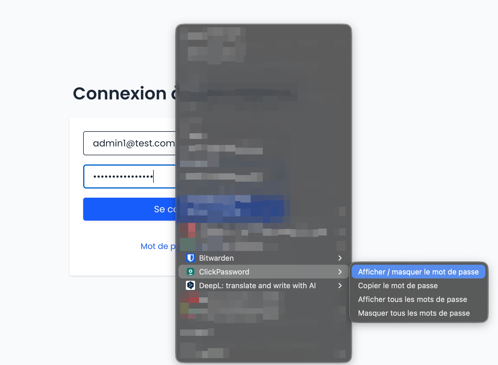

# ClickPassword

Extension Chrome (Manifest V3) pour afficher, masquer et copier les champs mot de passe — via clic droit, icône œil ou raccourci clavier.

## Aperçu
 |

## Installation

1. Ouvre Chrome → `chrome://extensions`
2. Active le **Mode développeur**
3. Clique **Charger l’extension non empaquetée**
4. Sélectionne ce dossier

Après une mise à jour des fichiers : **Recharger** l’extension, puis recharger les onglets ouverts.

## Utilisation

| Action | Comment |
| --- | --- |
| Afficher / masquer | Clic droit dans le champ → **Afficher / masquer le mot de passe** |
| Icône œil | Bouton à droite du champ password |
| Raccourci | `Option` + `Shift` + `P` (Mac) · `Alt` + `Shift` + `P` (Windows / Linux) |
| Tout afficher | Clic droit sur la page → **Afficher tous les mots de passe**, ou clic sur l’icône de l’extension |
| Tout masquer | Clic droit → **Masquer tous les mots de passe** |
| Copier | Clic droit dans le champ → **Copier le mot de passe** (sans l’afficher) |
| Options | Clic droit sur l’icône de l’extension → **Options** |

Astuce raccourci : clique d’abord dans le champ password, puis tape le raccourci. Tu peux le modifier dans `chrome://extensions/shortcuts`.

## Fonctionnalités

- Menu contextuel (toggle, copier, tout afficher / masquer)
- Icône œil discrète sur les champs
- Raccourci clavier (`⌥⇧P` / `Alt+Shift+P`)
- Auto-remasquer après X secondes (réglable, `0` = désactivé)
- Badge / contour sur les champs révélés
- Support des **iframes** et des **shadow DOM ouverts**

## Options

Accessible via clic droit sur l’icône → **Options** :

| Option | Description | Défaut |
| --- | --- | --- |
| Auto-remasquer | Délai en secondes avant de re-masquer | `10` |
| Icône œil | Afficher le bouton dans les champs | oui |
| Badge | Contour + pastille sur les champs en clair | oui |

## Limites

- Pages internes Chrome (`chrome://…`, Chrome Web Store) : non supportées
- **Shadow DOM fermé** (`mode: "closed"`) : inaccessible aux extensions
- Certains sites peuvent forcer à nouveau `type="password"` via leur JS
- Chrome n’autorise pas certains raccourcis (ex. `Ctrl+Alt+…`, 3 modificateurs)

## Structure

```
clickpassword/
├── manifest.json
├── background.js      # menus, raccourci, action
├── content.js         # œil, toggle, shadow DOM
├── content.css
├── options.html / options.js
└── icons/
```

## Licence

Usage personnel / libre — fais-en ce que tu veux.
